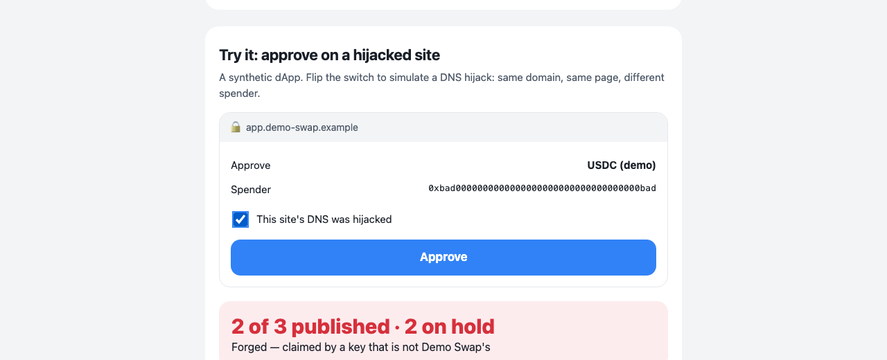

# Officially

**A hijacked frontend can change everything on the page except the project's key.**
Officially checks, right before you sign, that the contract or spender your wallet is asked to approve — and the site asking — were published by the project's own key on [Arkiv](https://arkiv.network), are still live, and are not under an incident the project raised. No server, no indexer: the check is one Arkiv query anyone can run.

- **Live app:** https://ryugi62.github.io/officially/ — no wallet, no sign-up. Flip "This site's DNS was hijacked" and press Approve.
- **Check from a terminal (no wallet):**
  ```bash
  npx github:Ryugi62/officially check-tx --chain 11155111 \
    --origin https://app.demo-swap.example \
    --to 0x5eed00000000000000000000000000000000aaaa \
    --data 0x095ea7b3000000000000000000000000bad0000000000000000000000000000000000bad00000000000000000000000000000000000000000000000000000000000003e8 \
    --root 0x70E5d4986A251a5173Acf59c86178e144B62864E
  # → TRANSACTION FORGED: the spender 0xbad0…0bad was "published" under Demo Swap's name by a key that is not Demo Swap's
  ```
- Data contract [`/arkiv/schema.md`](arkiv/schema.md) · Friction report [`/arkiv/friction.md`](arkiv/friction.md) · On-chain evidence [`/arkiv/evidence.md`](arkiv/evidence.md) · Feature check [`/arkiv/features.md`](arkiv/features.md) · Spec [`SPEC.md`](SPEC.md)
- Tracks: **Security** (primary), Censorship Resistance, Open Source. All demo data is synthetic: a fictional "Demo Swap" on `*.example` domains with made-up addresses.



## Who is misled today

| When | What happened | Loss | Source |
|---|---|---|---|
| 9–10 Aug 2022 | Curve's DNS was hijacked; the cloned site "requested approval to a malicious contract used to drain funds" | ~$570K | [Curve Market Cap newsletter](https://curve.substack.com/p/august-10-2022-curve-frontend-hacked) |
| 19–20 Sep 2023 | Balancer's frontend was hit by a DNS attack | over $250K | [Decrypt, 20 Sep 2023](https://decrypt.co/197953/balancer-frontend-hit-by-dns-attack-over-250k-stolen) |
| 12–13 May 2025 | Curve's DNS was hijacked **again**, sending users to a malicious site | not disclosed | [Cointelegraph, 13 May 2025](https://cointelegraph.com/news/curve-finance-warns-dns-hijacked-again) |

The pattern repeats because the victim does everything right: they type the real domain, see the real-looking page, and sign. **The domain is official; the spender is not.** A domain allowlist passes this attack. Officially checks the spender.

**What changes from day one.**
- *For the person signing:* they pin the project's root key once, from a source they trusted before any incident (the project's GitHub or ENS name; the app remembers it, and `?root=0x…` links share it). From then on, every approve they paste or click through the guard is checked against what that key published, and a drainer on the real domain shows **FORGED** or **not published**.
- *For the project:* one command on its next deploy (`officially publish …`), and its official sites, handles and contracts, plus any incident it raises, become checkable by anyone without trusting the project's DNS or its X account: from the web page, from scripts and bots (the CLI exits 0 only on a clean pass), and at the moment of signing. [`guardProvider`](src/adapters/wallet/guard.ts) wraps any EIP-1193 wallet provider so `eth_sendTransaction` and `eth_signTypedData_v4` are checked before the wallet shows them; the demo's Approve button goes through exactly that wrapper, and the hijacked approve is refused before the (demo) wallet ever sees it.
- *Who is still cut off:* someone who never pinned the project's key before the hijack. That is why the pin is offered from the project's GitHub/ENS anchors, and why a `?root=` link is never applied without the user confirming it.

## Per track

| Track | What the rubric asks | Where Officially does it |
|---|---|---|
| **Security** | "shows or filters Arkiv entities by their on-chain creator (`$creator`), not by a field anyone can write" | Every verdict comes from `$creator` filtered inside the query ([`reader.ts`](src/adapters/arkiv/reader.ts)); `project_slug`, labels and payloads are display-only. A property test generates random slugs and labels on a claim from another key and never gets `OFFICIAL` ([`verdict.test.ts`](tests/domain/verdict.test.ts), AC-5). The live demo's forged spender is "published" under Demo Swap's exact name and is shown as **FORGED**. |
| **Censorship Resistance** | "someone outside the team can read and query the data from Arkiv without the team's backend" | **Who is censored today:** a project under attack loses its own channels. When its DNS points to the attacker, the warning banner on its site is gone too, because the attacker serves the page; the people about to sign are cut off from the one warning that matters. An Officially incident is signed by the project's key, burned on creation, and readable from any Arkiv RPC, so the attacker who holds the domain cannot take it down. There is no backend: the app is static files on GitHub Pages talking to the public RPC. The `curl` in [Reproduce](#reproduce-it) reads everything with no code of ours. Incidents are burned on creation and kept alive by anyone, so neither the team nor an attacker holding its key can silence one. |
| **Open Source** | "another team can build on the dataset or tool without asking permission, from a documented data contract" | [`/arkiv/schema.md`](arkiv/schema.md) is the contract. [`examples/independent-check.mjs`](examples/independent-check.mjs) is a second client written from it alone: raw JSON-RPC plus keccak, nothing imported from `src/`. A test shows it reaches the same verdict as the app in 12 scenarios ([`independent-client.test.ts`](tests/adapters/independent-client.test.ts)). MIT. |

## What Officially is not (and what already exists)

| Existing | How it works | What it does not do that Officially does |
|---|---|---|
| [MetaMask eth-phishing-detect](https://github.com/MetaMask/eth-phishing-detect), [Blockaid](https://www.blockaid.io), [ScamSniffer](https://scamsniffer.io) | A vendor's block/allow list or scanner | Not authored by the project; a brand-new drainer on the official domain is unknown until a vendor flags it |
| [Reown (WalletConnect) Verify](https://docs.reown.com/appkit/domain-verification) | Checks the request comes from the registered domain | A hijacked official domain still verifies |
| [SEAL Safe Harbor](https://github.com/security-alliance/safe-harbor), [ENS text records](https://docs.ens.domains/ensip/5) | Project-signed address lists / records on Ethereum | Answering "which key published **this** address?" needs an indexer; no expiry, no incident state |
| Arkiv Canary, Lapse (other entries in this challenge) | Warrant canaries: an organization's liveness statement that dies if not renewed | Officially is not a canary: it checks the **addresses a signature would authorize** against the set the project's key published |

## Why Arkiv

| If we used… | What breaks |
|---|---|
| **Postgres behind our API** | It becomes a second hijackable frontend. Whoever takes over our DNS or server can rewrite "official", and history can be edited silently. Users must trust us. |
| **IPFS (+ IPNS / DNSLink)** | Content is addressed by hash, but "the latest list for project X" goes through IPNS or DNSLink — DNS again, the thing being attacked. There is no way to ask "which key published this address?" across projects, and nothing expires. |
| **A subgraph** | Needs a contract plus an indexer. The indexer is an operator, and expiry, leases and burned warnings would have to be rebuilt in Solidity. |
| **Our own signed JSON API** | Same single point of failure as the project's DNS, and the reverse lookup "who claims this spender" needs our server. |
| **EAS attestations** (closest relative: attester ≈ `$creator`, `expirationTime`, revocation) | "Which of these keys attested this exact address, and is it still live?" goes through EAS's indexer/GraphQL, an operator again. Expiry is fixed at creation (no lease renewed on deploy), there is no permissionless keep-alive, and a revocable attestation lets a stolen key retract a warning. |

**The one question only Arkiv answers natively:** *"which live entities on these target hashes were created by these keys?"* That is a reverse lookup by value, filtered by immutable author and by liveness, answered by the chain's own query engine in one read. Every alternative above needs an indexer someone runs, or loses authorship or expiry.

**The Arkiv properties Officially relies on, and what happens without them:**
- **Immutable `$creator`, filtered inside the query.** The verdict is one read: entities on these target hashes whose `$creator` is the project's root or publisher key (`$creator = addr(…) OR $creator = addr(…)` in `where()`). Remove it and the product falls apart: anyone with test GLM can write an identical claim, as our simulated attacker did, and only `$creator` tells them apart. The demo shows that claim as **FORGED**.
- **Entity Expiration as a lease.** An endpoint is official only while the publisher keeps renewing it. Retired endpoints lapse by themselves; three demo endpoints lapse on 20, 21 and 22 October, during judging.
- **`readonly` + `permissionlessExtension` + ownership transfer to `0x…dEaD` in one atomic batch.** A warning nobody — not even a stolen project key — can edit or delete, and anyone can keep alive.

**Honest caveat:** reads come from an RPC, and a lying RPC could fake answers, including `OFFICIAL`. The public RPC is one operator; Officially takes any other: the app accepts `?rpc=<your Arkiv node>`, the CLI reads `OFFICIALLY_RPC`, and the `curl` below is plain JSON-RPC. Arkiv's [Fundamentals](https://docs.arkiv.network/start-here/fundamentals/) describe watchers that replicate the chain and serve reads, with records committed to Ethereum for archival; we did not run a second node ourselves. We never run a server: the page, CLI and snapshot are static files.

**Kept off Arkiv on purpose:** private keys (keychain and environment variables only) · website contents and frontend bundles (large, and not what is attacked) · who checks what (verification runs client-side, nothing is logged) · the user's pinned project list (stays on their device) · raw anchor proofs (GitHub/ENS hold them; the project record only points to them).

## How Officially uses Arkiv

Every row is verified in the code **and** on Tiramisu by `npx tsx scripts/check-features.ts` (log: [`arkiv/repro-logs/check-features.log`](arkiv/repro-logs/check-features.log); full table with code links: [`arkiv/features.md`](arkiv/features.md)).

| Feature | What the user sees | Why |
|---|---|---|
| Typed attributes vs payload | Lookups by `target_hash` (bytes32); `severity` stored as i32 and `publisher` as addr; labels and advice stay in the payload | Index only what is filtered |
| Compound query with `$creator` in `where()` | One read checks a whole transaction (origin + contract + spender) | Spam claims by other keys cannot crowd a trusted claim out of the 200-result page |
| `createdBy()` + cursor pagination | Project records of the pinned root; a publisher renews all its claims | Authorship enforced by the node |
| Entity Expiration per type | Lease countdown on each verdict; retiring endpoints lapse | Project record 365 d · endpoint 30 d · incident 24 h / 72 h / 7 d by severity |
| Lifetime Extension as a lease | Endpoints stay official only while renewed on each deploy | Forgotten endpoints stop being official on their own |
| `readonly` + `permissionlessExtension` | Claims cannot be edited; anyone can keep a warning alive | A stolen key cannot rewrite history; a dark team cannot silence a warning |
| `$creator` vs `$owner`, ownership transfer | Verdicts name the creating key; incidents show owner `0x…dEaD` | Trust from the immutable creator; burned ownership means nobody can retract a warning |
| Atomic batch + `predictEntityKeys` salt | An incident appears already burned: there is no block in which a stolen key could delete it | Create and transfer land in the same block |
| Key rotation as one batch (create + delete of a readonly record) | Claims by the retired publisher read `REVOKED`; incidents it raised before retirement still restrict | Never zero or two authorized publishers ([log](arkiv/repro-logs/rotation.log)) |
| `watchEntityEvents` over WebSocket, no `fromBlock` | A new incident flips open checks to INCIDENT without a reload | Push arrived 817 ms after the write ([log](arkiv/repro-logs/ws-incident-latency.log)); polling would spend the RPC budget every judge shares |

## The model, in five rules

1. A project's **root key** (cold) signs a readonly `project` record naming its **publisher key** (hot).
2. The publisher signs readonly `endpoint` claims: a normalized target (`https://app.demo-swap.example`, `eip155:11155111:0x…`, `x:@handle`) hashed into `target_hash`, with a 30-day lease renewed on every deploy.
3. A check keeps only entities **created by** the root or the publisher. Names, slugs and labels anyone can write are displayed and never trusted.
4. New endpoints are held for **48 hours** (`PROBATION`) so a team can notice a stolen publisher key and rotate before anyone relies on what it published. The team's alarm is `officially watch --root <key>`: every entity its keys create is announced over a WebSocket as it lands ([log](arkiv/repro-logs/watch.log)). Rotation is one batch: new record plus deletion of the old one. Claims by the retired key then show as `REVOKED`. Done on Tiramisu on 12 Oct: [rotation log](arkiv/repro-logs/rotation.log) (`https://docs.demo-swap.example` was left on the retired key on purpose and reads `REVOKED`).
5. **Incidents only restrict.** They mark targets unsafe, never add or redirect. Their text renders without links, they are burned on creation, and anyone can keep them alive.

Verdicts: `OFFICIAL` · `PROBATION` · `INCIDENT` · `FORGED` · `REVOKED` · `UNLISTED` · `UNPINNED`. A transaction is as safe as the least safe address it authorizes. Decoded today: `approve`, `increaseAllowance`, `setApprovalForAll`, Permit2 `approve`, and EIP-2612 `Permit` typed data.

## Reproduce it

**1. Read the data without our code or servers (plain JSON-RPC):**
```bash
curl -s https://rpc.tiramisu.db-chain.testnet.arkiv.network -H 'content-type: application/json' -d '{"jsonrpc":"2.0","id":1,"method":"arkiv_query","params":["app = str('"'"'officially.v1'"'"') AND $creator = addr(0x04a16DA7180594eF2dFFcF70431e809432CE438F)",{"select":{"key":true,"attributes":true,"payload":true,"expiresAt":true},"limit":"0x20"}]}'
```
This returns every endpoint claim and incident Demo Swap's publisher key created. The payloads are hex-encoded JSON.

**2. The verdicts the demo shows (CLI, no wallet):**
```bash
R=0x70E5d4986A251a5173Acf59c86178e144B62864E   # Demo Swap's root key (also stated in demo/.well-known/officially.json)
npx github:Ryugi62/officially check https://app.demo-swap.example --root $R                               # OFFICIAL (PROBATION during its first 48 h)
npx github:Ryugi62/officially check eip155:11155111:0xbad0000000000000000000000000000000000bad --root $R   # FORGED
npx github:Ryugi62/officially check https://demo-swap-airdrop.example --root $R                           # INCIDENT (Demo Swap warns: fake airdrop site)
npx github:Ryugi62/officially check https://v1.demo-swap.example --root $R                                # OFFICIAL until 20 Oct 12:00 UTC, then UNLISTED (lease lapses)
npx github:Ryugi62/officially check https://docs.demo-swap.example --root $R                              # REVOKED: only the retired publisher key ever signed it
```
The exact queries behind these are printed in [`/arkiv/schema.md`](arkiv/schema.md#queries-the-app-runs-exact-strings-printed-by-npx-tsx-scriptsprint-queriests).

**3. Run everything locally:**
```bash
git clone https://github.com/Ryugi62/officially && cd officially && npm ci
npx vitest run                 # unit, contract and adapter tests
npm run dev                    # the web app
npx tsx scripts/check-features.ts && npx tsx scripts/measure-latency.ts 10
```

**4. Publish for your own project** (keys come from environment variables only, never from arguments or files):
```bash
OFFICIALLY_ROOT_KEY=…      officially rotate --publisher 0xYourHotKey --slug yourproject --name "Your Project" --anchor github=https://github.com/you/repo/blob/main/.well-known/officially.json
OFFICIALLY_PUBLISHER_KEY=… officially publish --slug yourproject --endpoint "https://app.yourproject.xyz|App" --endpoint "eip155:1:0xYourRouter|Router" --chain 1
OFFICIALLY_PUBLISHER_KEY=… officially renew                                # on every deploy (CI step)
OFFICIALLY_PUBLISHER_KEY=… officially incident --target https://old.yourproject.xyz --severity 2 --title "Retired" --advice "Do not sign there." --slug yourproject
```

## Wallets that create the entities (Tiramisu)

| Address | Role |
|---|---|
| [`0x70E5d4986A251a5173Acf59c86178e144B62864E`](https://tiramisu.explorer.arkiv.network/address/0x70E5d4986A251a5173Acf59c86178e144B62864E) | Demo Swap root key: project records |
| [`0x7169173d0D00db282f385FEE8BeCe2D67d10c6f0`](https://tiramisu.explorer.arkiv.network/address/0x7169173d0D00db282f385FEE8BeCe2D67d10c6f0) | Demo Swap publisher key (v2, since the 12 Oct rotation): endpoint claims, renewals, incidents |
| [`0x04a16DA7180594eF2dFFcF70431e809432CE438F`](https://tiramisu.explorer.arkiv.network/address/0x04a16DA7180594eF2dFFcF70431e809432CE438F) | Demo Swap's first publisher key, retired by the root on 12 Oct ([rotation log](arkiv/repro-logs/rotation.log)): its claims read REVOKED, the incidents it raised before retirement still count |
| [`0xcb7074f79E887426Eba3aE9039F0b2ed620a8d6e`](https://tiramisu.explorer.arkiv.network/address/0xcb7074f79E887426Eba3aE9039F0b2ed620a8d6e) | Simulated attacker: a forged claim under Demo Swap's name |
| [`0x81989FF0bCd1B25b9b751c53a7266904F83B5ec2`](https://tiramisu.explorer.arkiv.network/address/0x81989FF0bCd1B25b9b751c53a7266904F83B5ec2) | Community wallet: keeps an incident alive (permissionless extension) |

Every entity, a link to its explorer page (which shows its creation transaction) and its expiry: [`arkiv/evidence.md`](arkiv/evidence.md). Logs of the README commands: [`readme-commands.log`](arkiv/repro-logs/readme-commands.log). If the public RPC rate-limits your IP (anonymous budget ≈ 100 requests), the app falls back to [`snapshot.json`](public/snapshot.json) and says so.

## Limits

- Throughput: one check is ≤ 3 RPC requests, p50 664 ms / p90 1,598 ms over 10 checks on the public RPC ([log](arkiv/repro-logs/measure-latency.log)). The anonymous RPC budget (≈ 100 requests per IP, reported-issues #17) allows about 30 checks per IP before an access key is needed.
- Trust starts with pinning the right root key (trust on first use). Officially shows the anchors the project published (`demo/.well-known/officially.json`, GitHub, ENS). Pin **before** an incident, not during one.
- Decoded: `approve`, `increaseAllowance`, `setApprovalForAll`, Permit2 `approve`, and typed data whose `primaryType` is `Permit` (EIP-2612) or `PermitSingle` (Permit2). Anything else (multicall, Safe `execTransaction`, ERC-4337 UserOps, EIP-7702 authorizations, `wallet_sendCalls`, Permit2 batches, Seaport orders, any other typed data) is checked on the called or verifying contract only and flagged **"not decoded"**: never a clean pass in the app or the wallet guard, exit code 1 in the CLI.
- `readonly` stops edits, not deletion: the owner can delete its own endpoint claims. A stolen **publisher** key can therefore make endpoints disappear, which fails safe (everything reads "not published", nothing reads official) until the root rotates. It cannot delete incidents (owned by `0x…dEaD`), cannot shorten them (the node refuses an extension that would shorten a life — [log](arkiv/repro-logs/shorten-incident.log)), and a rotation does not silence the warnings a key raised while it was trusted. The reverse also holds: warnings a retired key raises *after* its retirement (or after the block the root declares it compromised, `rotate --compromised-since`) are shown but never restrict, so a thief cannot grief the project with burned, community-extendable warnings.
- Not defended: theft of the **root** key; malicious calldata that pays an official router to send funds elsewhere; wallets that do not expose the request before signing.
- Tiramisu is a testnet: entities are demo data and may be reset.

## What happens next

| When | Milestone | Target |
|---|---|---|
| 14 Oct 2026 | Demo endpoints leave their 48 h hold; the guard passes the genuine approve to the wallet | 3/3 addresses `OFFICIAL` on the live page |
| 20–22 Oct 2026 | Three demo endpoints retire on schedule during judging | `v1`, `Router v1`, `Beta` read "not published" after 12:00 UTC on their day |
| Nov 2026 | Browser-extension wrapper around `guardProvider` for one wallet, plus a SEAL Safe Harbor importer (labelled "mirrored", never `OFFICIAL`) | 1 wallet, ≥ 5 mirrored protocols |

## Pre-existing work, tools

- Pre-existing work: **None**. Everything was built between 12 and 18 October 2026 (first commit 12 October).
- LLMs used: Claude (Anthropic), as a coding assistant.
- License: MIT.
